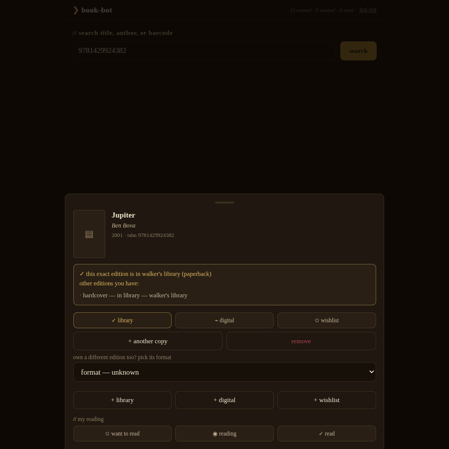
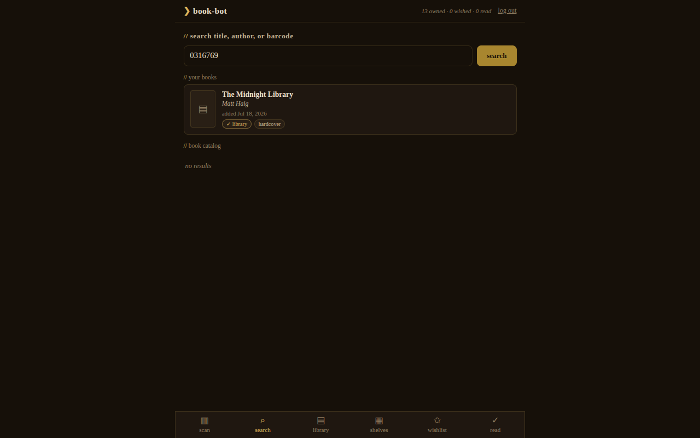

# book-bot

A self-hosted, mobile-first website for managing a home library. Scan a
book's barcode with a phone camera (or search by title, author or ISBN)
and file it on the shelves or the wishlist.

It exists for shopping trips. Every edition of a book has its own ISBN, so
a plain ISBN lookup cannot tell you that the paperback in your hand is a
story you already own in hardcover. book-bot groups editions into works,
so scanning any edition tells you whether you already own that story in
another binding, and whether you have already read it.



What it does:

- Barcode scanning in the browser, plus one search box for title, author
  or ISBN. Metadata comes from Google Books and Open Library, merged.
- Edition-versus-work grouping, so a scan answers "do I already have this?"
  even for an edition that is not in the database yet.
- Shared libraries: a household can co-own one library, while reading
  history (status, ratings, dates, notes) stays per user.
- A bulk add mode for shelving a whole stack with one tap per book.
- A 3D library view: the shelves render as a walkable rotunda with every
  book textured with its cover.


## How it answers "do I already have this?"

Every ISBN identifies one specific *edition* (hardcover, paperback and
special edition all have different ISBNs). book-bot stores a shared
catalog plus per-library and per-user layers:

- **works**: the story itself, grouped by the Open Library *work key*
  (which links all editions of a book), with a normalized title+author key
  as fallback when Open Library doesn't know the edition. Shared catalog.
- **editions**: one row per ISBN, pure catalog metadata (title, format,
  cover, ...). Also shared.
- **libraries / library_books**: who owns what. A library is a shelf that
  one *or several* users own together (a couple shares one home library).
  A `library_books` row is that library's copy of an edition, with status
  (`library` for a physical copy, `digital` for ebooks and audiobooks,
  `wishlist`), shared notes, and a `copies` count. A hardback plus two
  identical softbacks is two rows (one per edition) with `copies = 2` on
  the softback.
- **read_states**: per-user reading history, Goodreads-style. One row per
  user+work with status (`want to read` / `reading` / `read`), rating,
  private notes, and started/finished dates. Independent of ownership, so
  the app has a *"read but don't own"* view for library loans and borrowed
  books, and your spouse's shelves never inherit your ratings.

So when a scan finds an ISBN that isn't in the database, the app still
resolves its work and answers: *"not this edition, but you have this book:
hardcover, in library"*, and *"you read this in 2023"* with your rating.

The read tab's **trophies** filter crosses the two layers: books you've
*read* but own no *physical* copy of (borrowed, library loans, or
digital-only), each one a tap away from the wishlist for when you want it
on the shelf.

The same keys are the future Goodreads-sync seams: a Goodreads export
matches editions by ISBN-13 (falling back to the work's normalized
title+author key) and lands shelves, read dates and ratings in
`read_states`.

Book barcodes are Bookland EAN-13 (start 978/979) and *are* the ISBN.
Older mass-market paperbacks sometimes carry a retail UPC that doesn't
encode the ISBN. The app detects that and suggests scanning the barcode
inside the cover or searching by title.



## Bulk add

For shelving a stack: **bulk add a stack** on the scan tab keeps the camera
running and replaces the sheet with a card under the viewfinder. Scan, tap
the binding (the catalog's guess is highlighted), next book. Everything
lands in the active library.

A book that doesn't go in (unknown barcode, failed lookup) plays a low
double tone and stops the scanner until you answer, so the book in your
hand is the one that failed. Setting it aside keeps it in the session list
at its place in the stack: *not added, between "The Giver" and "Hatchet"*.
Tap an added row to fix its format, add a copy or remove it. The list is
kept on the device until cleared.

## Stack

- **backend**: FastAPI (Python, run with `uv`). Metadata from Google
  Books and Open Library, merged. Google Books requests authenticate with
  a service account (`GOOGLE_SERVICE_ACCOUNT` JSON, optional
  `GOOGLE_BOOKS_API_KEY`), because anonymous Books API calls are
  quota-blocked.
- **data**: the shared `apps` Postgres via **PostgREST** (identical
  pattern to load-log: `book_bot` schema, `book_bot_user` role, JWT bearer
  tokens). Logins are verified in-process by the
  [postgrest-auth](https://github.com/ReadableCode/postgrest-auth) library
  against `book_bot.users`, which signs the token PostgREST trusts. One
  backend, no fallback: a missing `POSTGREST_URL` or `JWT_SECRET` fails at
  import rather than quietly writing somewhere nobody reads.
- **frontend**: vanilla JS PWA in the terminal-navy style
  (style-terminal-navy tokens). Barcode scanning via the native
  BarcodeDetector API where available, vendored ZXing elsewhere
  (iPhone Safari). Installable to the home screen.
- **shelves**: the library tab renders a real-time 3D rotunda
  (vendored Three.js): wooden bookcases in an arc, each book a physical
  object textured with its cover, GSAP-driven flights when regrouping by
  genre, type or author. Falls back to a CSS bookcase without WebGL.

## Accounts and shared libraries

Users log in with their own account, or create one right from the login
screen ("create an account"; set `SIGNUP_ENABLED=false` to go
invite-only). The app fronts its own login hardening instead of sitting
behind Authelia: argon2id hashes, per-username/per-IP lockout (5 failures
in 15 minutes), signup throttling and security headers. Disabling an
account or changing its password revokes every session it already had.

You see your own books and nothing else. First login auto-creates a
personal library. From the library view's `▤` button you can rename it,
start another, or share it with another user by username; members see and
manage the same shelves. Users who existed before the multi-user
migration all co-own the migrated **Family Library**; users created later
start with an empty library of their own and can't see anyone else's. In
production this is enforced twice: the API scopes every query by
membership, and Postgres row-level security does the same underneath
PostgREST.

Reading history is never shared: read status, ratings, read dates and
reading notes are always per-user, whichever library the book sits in.

### Managing libraries from the CLI

Everything the `▤` button does (and a bit more) is also scriptable.
`scripts/manage_library.py` talks to Postgres directly (with the
superuser `POSTGRES_*` env vars, bypassing the API and RLS):

```sh
# see every library, its members and book counts
uv run python scripts/manage_library.py list

# create a shared library with members in one go
uv run python scripts/manage_library.py create --name "Cabin Books" \
    --member jason --member beca

# add someone to an existing library (name or uuid)
uv run python scripts/manage_library.py add-member \
    --library "Family Library" --username beca
```

Users themselves are created with `scripts/create_user.py`; members must
exist before they can be added. `scripts/manage_user.py` disables,
re-enables, changes the password on, or deletes a login. In production,
run these scripts inside the book-bot container, which has the right env
(see [`deploy/README.md`](deploy/README.md)).

## Run it locally

Local development runs against the real deployment; there is no offline
mode. `.env` (symlinked to `personal_credentials/personal.env`) supplies
`POSTGREST_URL`, `JWT_SECRET` and the superuser `POSTGRES_*` vars (login
reads the users table over that connection).

```sh
uv sync
uv run python scripts/create_user.py --username beca --password 'choose-one'
uv run uvicorn app.main:app --host 0.0.0.0 --port 8010
```

Open http://127.0.0.1:8010.

On startup the app applies its own schema (`app/bootstrap.py`, called from
the FastAPI lifespan): with the superuser `POSTGRES_*` env set it
idempotently applies the `deploy/*.sql` files and reloads PostgREST's
schema cache, skipping both when the recorded schema version already
matches. `scripts/init_db.py` is a thin wrapper for running the same step
by hand.

> Camera scanning needs a secure origin: `http://localhost` works on the
> same machine, but to scan from a phone you need HTTPS (deploy behind the
> reverse proxy, or use manual ISBN entry or title search).

## Tests

```sh
uv sync --group dev
uv run flake8 .
uv run pytest
```

The suite hits the real PostgREST and the real database (conventions
**I10**) using throwaway `ztest…` accounts that it creates and deletes.
An unreachable dependency is a red test, never a skip. Nothing it creates
is left behind.

## Production

See [`deploy/README.md`](deploy/README.md). Idempotent SQL files add the `book_bot` schema, role and
users to the shared `apps` database (the app applies them itself at
startup), PostgREST gets `book_bot` appended to `PGRST_DB_SCHEMAS`, and
the app runs with `POSTGREST_URL`/`JWT_SECRET` and the superuser
`POSTGRES_*` vars set, behind SWAG with HTTPS.

## Backups and restore

There is no book-bot-specific backup. The `book_bot` schema lives in the
shared `apps` database, which the server's nightly `pg_dumpall` covers
(03:00, 14 nights kept, mirrored to the backup host). The job, the restore
procedure, how to cut out just the `book_bot` schema, and the log of
restore drills are in the `personal_dev` repo's README under "Server
backups" and "Restoring the postgres backup".

## Importing old scans

Earlier barcode scans (JSONL in `~/SyncthingDB/Book-Bot`, states
`Wrapped`/`Wishlist`) can be replayed through the live API with full
metadata enrichment:

```sh
uv run python scripts/import_scans.py --file ~/SyncthingDB/Book-Bot/HoneyCrisp.jsonl \
    --username beca --password '...' --dry-run
```

## Repo layout

```
app/              FastAPI backend + static frontend (app/static)
deploy/           idempotent SQL + notes for the shared PostgREST stack
docs/screenshots/ screenshots of the app
scripts/          create_user.py, manage_user.py, manage_library.py,
                  import_scans.py, seed_books.py, init_db.py
tests/            pytest suite (real PostgREST + real database)
```
